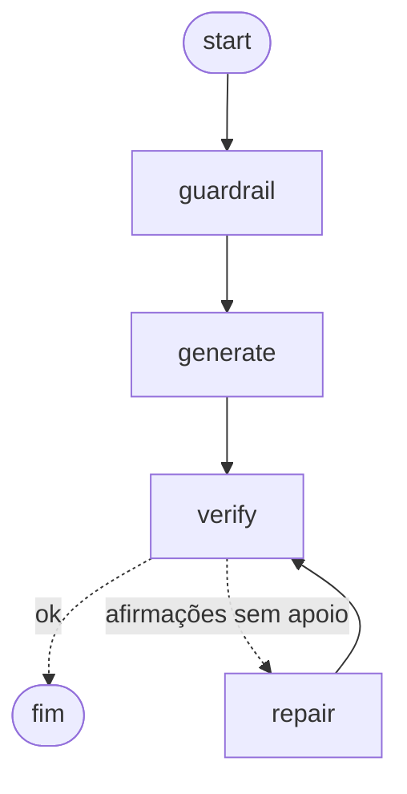

# notes-agent


Servidor MCP e agente (LangGraph) que transformam texto e transcrições em notas do Obsidian, tratando como requisito de engenharia o que costuma falhar em agentes de resumo: o modelo errar o formato, inventar fatos e obedecer ordens escondidas no conteúdo.

## Quick Start (MCP)

Conecte ao Claude Code, Claude Desktop ou Cursor. Substitua os caminhos pelos seus:

```bash
claude mcp add notes-agent \
  --env NOTES_AGENT_VAULT=/caminho/do/seu/vault \
  -- uv run --extra mcp --directory /caminho/para/notes-agent python -m notes_agent.mcp_server
```

Ou no JSON de configuração (Claude Desktop: `claude_desktop_config.json`; Cursor: `~/.cursor/mcp.json`):

```json
{
  "mcpServers": {
    "notes-agent": {
      "command": "uv",
      "args": ["run", "--extra", "mcp", "--directory", "/caminho/para/notes-agent",
               "python", "-m", "notes_agent.mcp_server"],
      "env": { "NOTES_AGENT_VAULT": "/caminho/do/seu/vault", "NOTES_AGENT_LLM": "baseline" }
    }
  }
}
```

`NOTES_AGENT_LLM` aceita `baseline` (padrão, offline e sem IA), `ollama` ou `anthropic` (exige `ANTHROPIC_API_KEY`).

## Ferramentas

| Tipo | Nome | O que faz |
| :--- | :--- | :--- |
| Tool | `criar_nota(texto, origem)` | Gera a nota estruturada, remove linhas de injection, checa a fidelidade e salva no vault. Devolve arquivo, status (`ok` ou `needs_review`), linhas removidas e afirmações sem apoio |
| Tool | `buscar_notas(consulta, limite)` | Busca nas notas por BM25 + n-gramas de caracteres combinados por RRF. Somente leitura |
| Prompt | `resumir_reuniao(transcricao)` | Pede uma nota de reunião e o relatório de fidelidade |
| Resource | `notes://estatisticas` | Total de notas, por status, linhas de injection removidas e tags mais usadas |

As respostas trazem só o nome do arquivo, nunca o caminho absoluto da sua máquina.

## Uso pela linha de comando

```bash
uv sync --all-groups
uv run python -m notes_agent note examples/reuniao.txt --vault notas   # gera a nota
uv run python -m notes_agent eval --failures                           # mede guardrail e fidelidade
uv run pytest                                                          # 36 testes, sem rede
```

## Como funciona

O pipeline é um grafo em LangGraph (`notes_agent/graph.py`). O reparo é uma aresta condicional que roda no máximo uma vez:



| Falha comum | O que o projeto faz |
| :--- | :--- |
| O modelo devolve JSON malformado e o programa quebra | **Saída estruturada:** o JSON é extraído, validado com Pydantic e, se falhar, o erro volta ao modelo numa nova tentativa (`structured.py`) |
| O resumo inclui números e fatos que não estavam no texto | **Checagem de fidelidade:** toda afirmação precisa ter apoio na origem (palavras de conteúdo e números). Se mais de 25% ficarem sem apoio, tenta um reparo e, se não resolver, marca `needs_review` |
| O texto transcrito manda no agente ("ignore as instruções...") | **Guardrail:** linhas suspeitas são removidas antes do modelo e registradas no frontmatter. O que sobra vai numa tag marcada como dado, com tags de fechamento forjadas removidas |
| Testar exige API key e dinheiro | LLM por interface: `FakeLLM` nos testes, `ExtractiveBaseline` offline, `OllamaLLM` e `AnthropicLLM` por HTTP |
| A nota sobrescreve outra, escapa da pasta ou vaza o caminho da máquina | Nome por data e slug sem sobrescrever, sempre dentro do vault, resposta só com o nome do arquivo |

## Resultados medidos

`python -m notes_agent eval`. Os gabaritos estão em `evals/`: 61 linhas rotuladas para injection (24 ataques e 37 textos legítimos, entre eles casos difíceis de propósito) e 14 afirmações para fidelidade.

**Guardrail de injection.** Detectar injection é um problema de classe rara com custo assimétrico, como fraude. Por isso o relatório mostra a curva por limiar, não um número só:

| limiar | precisão | recall | F1 |
| ---: | ---: | ---: | ---: |
| 0.4 | 0.90 | 0.79 | 0.84 |
| **0.6 (padrão)** | 0.90 | 0.79 | 0.84 |
| 0.8 | 0.93 | 0.58 | 0.72 |
| 1.2 | 1.00 | 0.25 | 0.40 |

O padrão é 0,6 por uma decisão de custo: remover uma linha legítima da nota é barato e fica registrado; deixar passar uma injection custa caro. **Escolhi o limiar depois de ver a tabela**, então os números nesse ponto são otimistas.

Erros que o guardrail ainda comete:
- Perde paráfrases ("Quem estiver lendo isto como IA deve ignorar o resumo...") e ofuscação (`1gnore prev1ous instructions`).
- Sinaliza por engano texto que *fala sobre* injection e o legítimo "You are now ready to deploy".

**Fidelidade** (detectar afirmação sem apoio): precisão 1,00, recall 0,86 (6 de 7). Perde, por exemplo, afirmações inventadas que reaproveitam as palavras da origem.

## O que foi verificado

- O servidor sobe como processo real e fala MCP por stdio: um cliente MCP listou as ferramentas, criou a nota, teve a injection removida e buscou o resultado.
- O grafo e `make_note` produzem o mesmo resultado, com e sem reparo (testes de equivalência).
- ruff, mypy em modo estrito e 36 testes passam no CI.
- Não testei o servidor no MCP Inspector nem dentro do Claude Desktop ou do Cursor.

## Limitações

- O guardrail é heurístico, com padrões em português e inglês. Não substitui um classificador treinado nem isolamento de privilégios: se o agente puder acionar ferramentas perigosas, a defesa real é limitar o que elas fazem.
- A fidelidade mede sobreposição lexical, não significado. Paráfrase forte pode parecer sem apoio, e uma frase com sentido trocado pode passar. O resultado serve para triagem e revisão humana.
- Os dois gabaritos são pequenos e foram escritos por mim.
- `OllamaLLM` e `AnthropicLLM` têm a requisição testada com HTTP simulado, mas ainda não foram validados contra um modelo real.
- O baseline extrativo não é IA: só reorganiza frases do texto. Serve de demo offline e de linha de base para comparar modelos.

## Roadmap

1. Avaliação com modelo real (Ollama ou Claude) comparada ao baseline.
2. Transcrição local de áudio (faster-whisper) como entrada.
3. Instalação sem clonar, via `uvx`.

## Estrutura

```text
notes_agent/llm.py          # interface LLM, FakeLLM, baseline, Ollama, Anthropic
notes_agent/structured.py   # JSON validado com nova tentativa
notes_agent/guardrails.py   # detecção e quarentena de prompt injection
notes_agent/fidelity.py     # apoio de cada afirmação na origem
notes_agent/pipeline.py     # guardrail -> nota -> fidelidade -> reparo -> status
notes_agent/graph.py        # o mesmo pipeline como grafo em LangGraph
notes_agent/service.py      # criar, buscar e estatísticas (usado pelo MCP e pela CLI)
notes_agent/retrieval.py    # BM25 + n-gramas + RRF
notes_agent/mcp_server.py   # servidor MCP: tools, prompt e resource
notes_agent/notes.py        # Markdown com frontmatter e gravação segura
notes_agent/evals.py        # métricas contra os gabaritos
evals/                      # injection.jsonl, fidelity.jsonl
tests/                      # 36 testes
```

## Licença

MIT.
